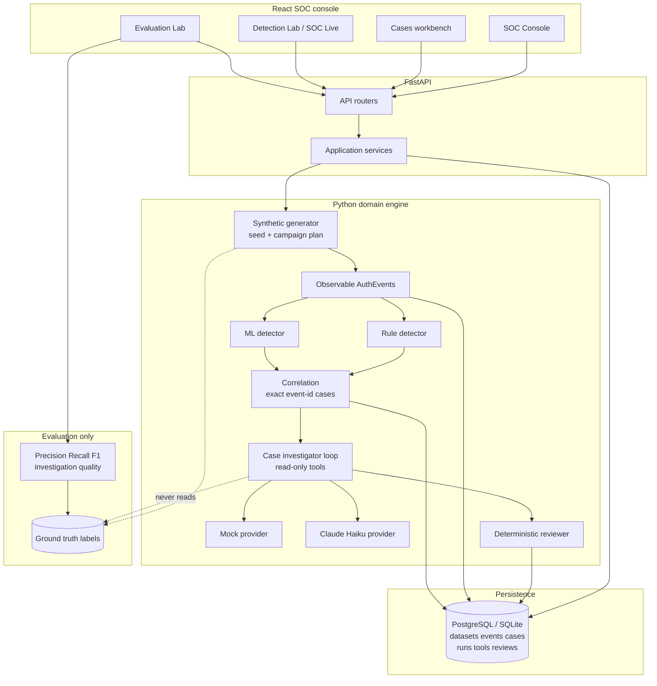
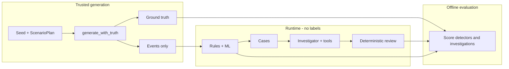
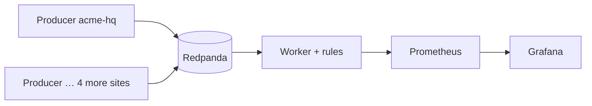

# Login-log anomaly explorer

A local, reproducible prototype for detecting suspicious authentication activity in **synthetic** login logs. It generates labelled traffic, runs a rule detector and an ML baseline independently, groups their signals into label-free cases, investigates each case with a bounded read-only investigator (mock baseline or optional Claude Haiku), reviews the result deterministically, and compares everything against ground truth only at evaluation time.

Primary UI: React SOC console + FastAPI + PostgreSQL/SQLite. Streamlit remains available as a secondary demo. Read `docs/agentic-evaluators.md` for component status before drawing conclusions.

## How the product works

End-to-end flow (runtime never sees ground-truth labels; evaluation joins them only after a run finishes):



Trust boundary in one picture:



Three ways data enters the product:

| Path | What it does | Where you see it |
| --- | --- | --- |
| **Seed demo** | Batch generate → detect → correlate → investigate → persist | SOC Console, Cases |
| **SOC Live** | Time-release events via `advance` (UI auto-ticks) → same pipeline in-process | Detection Lab |
| **Multi-site pipeline** | 5 tenant producers → Redpanda (Kafka API) → worker → Prometheus/Grafana | Pipeline page |

Pipeline stages stay independent: rules and ML do not fuse scores; the investigator only uses allowlisted read-only tools; the reviewer checks citations/policy without labels.

### Demo path (product story)

The SOC Console surfaces a fixed **Demo path**: seed → multi-site streams → SOC Live → investigate → evaluate, plus a **Trust model** panel (synthetic data, GT isolation, agent containment, independent detectors, honest baselines). Follow those steps in a live interview; the talking points are also returned by `GET /api/v1/product/demo-path`.

### Multi-site event pipeline (optional Compose profile)

Five synthetic sites/subsidiaries (`acme-hq`, `acme-latam`, `acme-emea`, `northwind`, `contoso-jp`) each own a topic. Producers publish namespaced `AuthEvent` envelopes; a worker consumes, runs the rule detector, and exports Prometheus metrics. Grafana ships a provisioned dashboard. **Kubernetes is the production narrative**, not a required local dependency — Compose proves the event-driven path.

```bash
# Core product
docker compose up --build

# Product + broker + observability
docker compose --profile pipeline up --build
```

| Service | Port | Role |
| --- | --- | --- |
| Redpanda | `19092` (Kafka), Console `8081` | Kafka-compatible broker |
| pipeline-producer | — | Publishes batches per tenant |
| pipeline-worker | `9100` | Consumer + `/metrics` |
| Prometheus | `9090` | Scrapes the worker |
| Grafana | `3000` (admin/admin) | Multi-site dashboard |



## Install

Python 3.11 or newer.

```bash
python3 -m venv .venv
.venv/bin/python -m pip install -e ".[dev,ml,dashboard,api,agents,pipeline]"
cp .env.example .env
```

Extras: `dev` (pytest, httpx), `ml` (scikit-learn), `dashboard` (Streamlit), `api` (FastAPI, SQLAlchemy, Alembic, Postgres driver), `agents` (Anthropic SDK for Claude Haiku), `pipeline` (kafka-python + prometheus-client for Redpanda producers/workers). The generator, the rule detector, and the contracts need no third-party runtime packages.

## Product UI (React) + API

Primary product surface: React console + FastAPI + PostgreSQL.

```bash
# API (SQLite for local quickstart; use Docker Compose for Postgres)
export DATABASE_URL=sqlite+pysqlite:///./data/login_anomaly.db
mkdir -p data
.venv/bin/uvicorn login_anomaly.api.app:app --factory --reload --port 8000

# Frontend
cd frontend && npm install && npm run dev
```

Open http://localhost:5173. Seed a demo dataset from the SOC Console, open a case, run a mock investigation (or Haiku if `ANTHROPIC_API_KEY` is set).

### Docker Compose

```bash
docker compose up --build
# optional distributed path:
docker compose --profile pipeline up --build
```

Core services: Postgres (`5432`), API (`8000`), frontend (`8080`). Migrations run on API start (`alembic upgrade head`). Pipeline profile adds Redpanda, producer, worker, Prometheus, and Grafana (see above).

### Claude Haiku

Set in `.env` (never commit secrets):

```bash
ANTHROPIC_API_KEY=...
ANTHROPIC_MODEL=claude-haiku-5-5
INVESTIGATOR_DEFAULT=mock
```

Without a key the API starts and uses the mock investigator. Haiku requests return HTTP 503 until configured. The UI labels every run as **Mock baseline** or **Claude Haiku**.

## Test

```bash
.venv/bin/python -m pytest -v
```

No external service is called. No LLM is called. The suite takes a few seconds.

## Run the experiment

Trains the ML baseline on four generated datasets and evaluates on two others, with the rule detector and a trivial baseline on the same held-out rows.

```bash
.venv/bin/python -m login_anomaly.evaluation.experiment --out reports/experiment.json
```

Results are written to `reports/experiment.json`. The file is deterministic: the same command gives identical output. It is committed as the reviewed artifact; regenerate it only when the experiment changes. Each evaluation set reports detector metrics (`methods`) and, separately, the workflow's investigation and case-investigation quality (`investigation`, `case_investigation`). All numbers are synthetic, from 2 seeds (nominal sets) or 3 seeds (boundary stress set) per evaluation set, and the model is trained on 4 training seeds. Read the `limitations` field before quoting any number.

## Run the dashboard

```bash
.venv/bin/python -m streamlit run src/login_anomaly/dashboard/app.py
```

Tabs: generate events, **SOC Live** (below), run the detectors, explore alerts with their evidence, and compare against labels (evaluation only). **Investigations** shows the case workbench first: rule-backed cases (a rule alert plus any ML signal on the same event) and ML-only cases (ML positives with no rule alert), each with its mock investigator run, the deterministic reviewer output, and the execution mode. Below it sits the native rule-alert investigator with an optional evaluation against labels. The **Threat Lab (labels)** tab runs the scenario catalog on fixed seeds, compares rules and ML per scenario, and runs one mock scenario proposal after it has passed the fixed-schema validation.

Every execution mode shown in the UI is `mock`. Nothing in the dashboard calls a paid or external service.

### Commands for manual testing

```bash
# 1. Full test suite (about 15 seconds, no network)
.venv/bin/python -m pytest -q

# 2. Workflow, cases, investigator, reviewer, and evaluation only
.venv/bin/python -m pytest -q tests/test_workflow.py tests/test_workflow_evaluation.py tests/test_correlation.py tests/test_case_investigator.py tests/test_scenario_proposals.py

# 3. Minimal end-to-end run: generate, detect, build cases, investigate, review, evaluate, write the experiment JSON
.venv/bin/python -m login_anomaly.evaluation.experiment --out /tmp/login-anomaly-e2e.json

# 4. Dashboard (open the printed local URL)
.venv/bin/python -m streamlit run src/login_anomaly/dashboard/app.py
```

Manual acceptance checklist (dashboard, default sidebar values):

- [ ] **Generate** tab shows a dataset with a seed and manifest.
- [ ] **Detectors** tab shows rule alerts and an ML line "Flagged N events".
- [ ] **Investigations** → Case workbench lists cases with both `rule_backed` and `ml_only` kinds (the default seed has both) and the caption shows `mode: mock`.
- [ ] Selecting a case shows its verdict, evidence, tool calls, and reviewer output (`quality`, `policy_findings`, `uncertainty`).
- [ ] Turning off the evaluation toggle hides every label-based metric; the native rule-alert table still renders.
- [ ] **Threat Lab** shows the scenario catalog, the rules-versus-ML table, and a "Mock scenario proposal" row with `strategy` `agent_proposal`.
- [ ] Changing the seed or campaign counts re-runs the workflow without an error page; an impossible plan shows "Generation rejected" rather than a crash.

## SOC Live

SOC Live transforms the platform into an enterprise security operations center console. Events are streamed over simulated time, and detectors, correlation, and mock investigation agents process incoming activity incrementally.

### Information Architecture & Visual Hierarchy

The redesigned console organizes security telemetry into clear, prioritized layers:

1. **Active Detection Engines & Controls**:
   - Independent feature flags:
     - **Rule-based detector** (ON/OFF): evaluates events against signature rules (bruteforce, spraying, impossible travel).
     - **ML baseline detector** (ON/OFF): scores events with supervised Random Forest model (prob $\ge 0.5$ flags ML-positive signals).
   - Four supported configurations:
     - `Rules + ML`: Dual detection with full exact-ID correlation and provenance-bound cases.
     - `Rules only`: Incidents and cases originate exclusively from signature rule alerts.
     - `ML only`: Incidents and cases originate exclusively from event-level anomaly flags.
     - `Neither detector`: Pure ingestion baseline (events are released and processed without generating alerts or cases).
   - Source & playback configuration: Mode (Replay / Continuous), Replay scenario, Seed, Attack families, and Events per second rate slider.
   - Lifecycle controls: **Start**, **Pause** (temporarily stops releases), **Resume** (continues at current position), **Stop** (terminates run), and **Reset** (clears session state to idle).

2. **Dual-Tier Live Metrics**:
   - **Tier 1 (Operational Ingestion Stream)**: Released events, Processed events, Pending queue, Simulated time (UTC), Elapsed wall time, and Effective release rate.
   - **Tier 2 (Detection & Triage Pipeline)**: Rule alerts, Open cases (within 2-hour window), Completed investigations, Tool calls (with error tally), and ML-only budget-capped cases.

3. **Case Triage & Progressive Disclosure Case Dossier**:
   - Replaces raw JSON dumps with a scannable triage table (Case ID, Origin Kind, Priority, Signals, Events, Verdict, Review Quality, Status).
   - Interactive **Case Dossier** for any selected case:
     - **Header & Provenance**: Origin badge (`Rule-backed` vs `ML-only`), Priority, Signals count, Retention window status.
     - **Contributing Detector Signals & Correlation**: Exact rule signatures or ML threshold scores, with correlation basis narrative (`exact_alert_event_id`, `unmatched`, `ambiguous`).
     - **Observable Authentication Events**: Filtered table of supporting login logs (timestamp, account, source IP, country, outcome).
     - **Investigation Findings**: Transparent disclosure of deterministic mock agent, final verdict badge, confidence score, evidence citations, and expandable step-by-step tool trace.
     - **Reviewer Audit**: Runtime verification checks, evidence validity, and policy uncertainty flags.
     - **Raw Case JSON**: Expandable technical payload for developer debugging.

4. **Telemetry & Observability Tabs**:
   - Live Event Stream (latest observable events).
   - Recent Rule Alerts (sliding-window incidents).
   - Investigation Activity Log (chronological agent timeline).
   - Engine Observability (internal state transitions and timings).

5. **Completed Run Evaluation & Fair 4-Way Detector Experiment**:
   - **Evaluate Completed Replay Run**: Scores a completed or paused replay simulation against held-out ground truth. Distinguishes operational counts from held-out quality metrics (Precision, Recall, F1, TP, FP, FN) for rules and ML independently.
   - **Controlled 4-Way Detector Benchmark**: Executes all 4 detector configurations on the exact same replay scenario and seed. Proves real detector flag semantics and provides side-by-side operational vs accuracy comparison on identical event streams.

### Operating Semantics & Constraints

- **Event Buffer & Retention Window**: Ingestion maintains a sliding 2-hour simulated-time context window (up to 5,000 events). Events older than 2 hours leave the window; cases whose evidence has expired are marked "closed".
- **Exact-ID Correlation**: The system matches ML-positive signals to rule alerts using exact event-ID equality. It does not perform fuzzy heuristic clustering.
- **Investigation Budget**: ML-only cases (frequently false alarms on benign noise) are capped at 25 automated investigations per session to conserve agent resources.
- **Ground-Truth Isolation**: Runtime modules (`live/`, `workflow.py`, `correlation.py`, `agentic/`, `dashboard/view.py`) strictly never import `evaluation` or ground-truth labels. Label comparison only occurs offline or post-run via `evaluation/live.py`.
- **Mock Disclosures**: Investigator and Reviewer are deterministic local mocks. No external LLM or API keys are required.

Commands:

```bash
# Focused SOC Live tests (engine, sources, live evaluation, headless dashboard)
.venv/bin/python -m pytest -q tests/test_live_engine.py tests/test_live_sources.py tests/test_live_evaluation.py tests/test_dashboard_live.py

# Launch Dashboard:
.venv/bin/python -m streamlit run src/login_anomaly/dashboard/app.py
```

Manual acceptance checklist (SOC Live tab):

- [ ] **Initial Idle State**: Status reads "No simulation is running", Start is enabled, Pause/Reset disabled, Mock agent banner is prominently displayed.
- [ ] **Detector Feature Flags**: Toggling Rule-based detector or ML baseline updates the configuration caption immediately ("Rules + ML", "Rules only", "ML only", "Neither detector").
- [ ] **Ingestion Baseline (Neither detector)**: Unchecking both detectors and clicking Start streams and processes events, while Rule alerts and Cases remain at 0.
- [ ] **Replay Simulation**: Select scenario "Mixed campaigns", seed 31, rate 5. Press Start. Events stream and metrics advance.
- [ ] **Case Dossier**: When cases appear, select one in "Inspect case". The Case Dossier displays Origin, Contributing Signals, Events, Mock Reasoning, and Tool Trace without raw JSON clutter.
- [ ] **Lifecycle Controls**: Pause stops event release; Resume continues smoothly; Stop transitions to COMPLETED with "Stopped by user".
- [ ] **Replay Evaluation**: Click "Score Run Against Ground Truth". Verify separate precision, recall, and F1 metrics for Rule and ML detectors.
- [ ] **4-Way Benchmark**: Click "Run 4-Way Benchmark". Verify the comparison table displays all 4 variants side-by-side with identical processed counts and expected detector differences.

## Layout

```
src/login_anomaly/
  events.py              AuthEvent contract (observable fields only)
  validation.py          shared validation helpers
  simulation/            generator, scenarios, ground truth, manifest, config
  detection/rules.py     rule detector (events only)
  ml/                    causal features and the baseline model (events only)
  workflow.py            label-free runtime workflow (rules, ML signals, cases, investigation, review)
  correlation.py         exact event-id association of rule alerts and ML signals into cases
  evaluation/            metrics, experiment, workflow evaluation, Threat Lab runner, evaluation panel
  agentic/               contracts, tools, native investigator, case investigator, reviewer, mock provider
  threat_lab/            scenario catalog, specs, and validated scenario proposals
  live/                  SOC Live: replay and continuous sources, and the incremental service
  dashboard/             view logic (no Streamlit) and the Streamlit app
docs/agentic-evaluators.md   design, diagram, contracts, status
```

## Ground-truth boundary

Labels exist only in `simulation/ground_truth.py` and are returned only by `generate_with_truth()`. A static test (`tests/test_ground_truth_isolation.py`) fails if any module outside `simulation/` and `evaluation/` imports the ground-truth module or the truth-bearing names. A second parametrized test fails if a runtime module (workflow, correlation, agentic, proposals, dashboard view) imports the `evaluation` package at all, so labels cannot reach runtime through it. This is a structural guard. It does not catch dynamic imports, and it is not a runtime security boundary.

## Agent Roles (Mock & Deterministic)

The MVP defines three bounded agent roles in the investigation and threat evaluation loop:

1. **Investigator Agent** (`src/login_anomaly/agentic/case_investigator.py`, `provider.py`):
   - Receives an investigation case with observable events only.
   - Operates in a strictly bounded loop (step, time, and retry budgets) using read-only inquiry tools (`tools.py`).
   - In the current MVP, operates via `MockInvestigatorProvider` producing deterministic evidence-backed verdicts without calling an external LLM.
2. **Investigation Reviewer** (`src/login_anomaly/agentic/reviewer.py`):
   - Performs independent, rule-based auditing of each completed investigation.
   - Validates event citation integrity, policy compliance, uncertainty reporting, and flags zero-confidence or error states.
3. **Threat Lab Scenario Proposer** (`src/login_anomaly/threat_lab/proposals.py`):
   - Generates candidate adversarial attack and decoy scenario specifications (`ScenarioSpec`).
   - In the current MVP, uses a deterministic mock proposer whose outputs must strictly conform to frozen schema validation before reaching the evaluation runner.

## Limitations

- Synthetic data only. The nominal set shares its thresholds with the rule detector, so its rule scores are optimistic by construction (rules F1 0.964, ML 0.990).
- With benign decoys (everyday look-alikes, assumed not measured), precision drops for both methods: rules F1 0.79, ML 0.78. Most false alarms come from a shared office address that spraying rules flag, and from roaming logins that travel rules flag.
- The boundary stress set sits just outside the rule thresholds by design. It shows how fast rules fail at their edge (rules F1 0.01, ML 0.70). It is not evidence of generalization. A real shift test (different attacker behaviour, far from the thresholds) is future work.
- The ML baseline was trained on the nominal specification only. None of these numbers estimates performance on real logs, and 2 or 3 seeds per evaluation set are too few to rank the methods with confidence.
- The dashboard seed control stops at 2^53-1, the largest integer a browser number holds exactly. The generator accepts up to 2^63-1.
- The default investigator is a deterministic mock. It shows the bounded loop, validation, and review contracts. It marks every rule-backed case malicious, so mock case verdicts are not a measure of LLM quality. Claude Haiku is optional via `ANTHROPIC_API_KEY`.
- Case correlation uses exact event-id matches only. An ML signal on an event covered by two alerts stays an ML-only case, with its candidates recorded, rather than being attached to either alert.
- The reviewer is deterministic (citations, zero-confidence verdicts, recorded errors). It is not an independent model judgment.
- Continuous live simulation generates independent chunks; user account and IP histories do not persist across chunk boundaries.
- ML-only case investigations are capped at 25 per live session.
- Docker Compose files are provided; verify `docker compose up --build` on your machine if the daemon was not available during development.

## Productization status (plan closed)

Closed against the MVP productization plan:

- React SOC console + FastAPI + SQLAlchemy persistence + Alembic migrations
- Mock + Haiku providers, deterministic reviewer, evaluation lab, Threat Lab API/UI
- SOC Live with auto-advance UI and persistence of live cases into the Cases DB
- CI: pytest + frontend vitest/tsc/build
- Ground-truth isolation tests preserved

Intentionally deferred (storytelling / post-MVP product polish, not engineering blockers):

- Narrative onboarding / demo script UX
- Semantic LLM reviewer
- Distributed workers / Kafka / K8s
- Stronger visual polish pass beyond the current console

## Planned Future Work

- Optional semantic LLM reviewer (deterministic reviewer remains the primary audit).
- Persistent account/IP feature stores across continuous live chunks.
- Streaming ingestion / distributed workers (explicitly out of MVP scope).
- Advanced ML beyond the supervised synthetic baseline.
- Product storytelling / guided demo narrative in the UI.

## Architecture notes (productization)

- Domain engine stays in `src/login_anomaly/` (simulation, detection, ML, correlation, agentic, live, evaluation).
- New layers: `api/` (FastAPI), `services/` (orchestration), `persistence/` (SQLAlchemy), `frontend/` (React).
- Streamlit dashboard remains available as a secondary demo UI.
- Visual language for the React console follows OnTimeAI-Frontend cues: light neutral chrome, near-black primary, color reserved for risk/verdict semantics.
