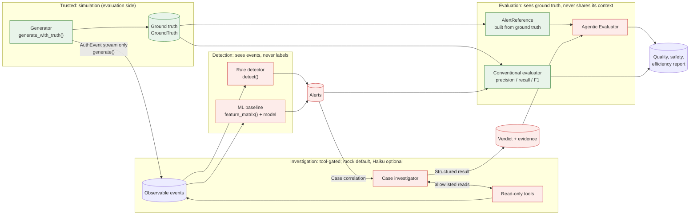

# Agentic Evaluators: design, contracts, and status

This document describes the agentic part of the project. Read the status table first. It separates what is implemented and tested from what is optional / unpaid.

## 1. Status

| Component | Status | Where |
| :- | :- | :- |
| Synthetic authentication environment (generator, scenarios) | Implemented, tested | `src/login_anomaly/simulation/` |
| Ground-truth isolation | Implemented, structural AST guard | `tests/test_ground_truth_isolation.py` |
| Rule detector | Implemented, tested | `src/login_anomaly/detection/rules.py` |
| ML baseline | Implemented, tested on synthetic data | `src/login_anomaly/ml/` |
| Conventional evaluator | Implemented, tested | `src/login_anomaly/evaluation/` |
| Investigation contracts and tool policy | Implemented as data types and constants | `src/login_anomaly/agentic/contracts.py` |
| Agentic Evaluator (scoring of a result) | Implemented, tested on **deterministic fixtures** | `src/login_anomaly/evaluation/agentic.py` |
| Deterministic investigator (rule-based stand-in, no LLM) | Implemented, tested; used in workflow helpers | `src/login_anomaly/agentic/investigator.py` |
| Case Investigator (tool-gated loop) | Implemented, tested on **mock provider**; optional **Haiku** when `ANTHROPIC_API_KEY` is set | `case_investigator.py`, `provider.py`, `haiku_provider.py` |
| Case Reviewer (runtime evaluator, no labels) | Implemented, tested; rule-based checks, not a model judgment | `src/login_anomaly/agentic/reviewer.py` |
| Offline workflow evaluation (labels, after the run) | Implemented, tested | `src/login_anomaly/evaluation/workflow.py` |
| Scenario Generator Agent (proposal schema) | Implemented, tested on the **mock provider** only; proposals are validated and never executed as code | `src/login_anomaly/threat_lab/proposals.py` |
| Read-only investigation tools | Implemented, tested, over in-memory observable events (no SQL via tools) | `src/login_anomaly/agentic/tools.py` |
| Stream pipeline worker | Implemented: Redpanda consume → **rules only** → Prometheus. Does **not** persist cases or run ML | `src/login_anomaly/pipeline/worker.py` |

### Honesty notes

- **Default investigator is mock.** Haiku is an optional adapter (`haiku_provider.py`). Python still enforces allowlists, budgets, and result validation.
- **CI / default tests do not call Anthropic.** Do not claim Haiku quality without a printed Evaluation Lab run.
- **Labels stay offline.** Detectors and investigation tools never receive ground truth.
- **Pipeline ≠ product cases.** Seed and SOC Live write Postgres. The Compose `pipeline` profile proves broker + metrics.

## 2. End-to-end flow

## 3. Contracts (short)

- Tools are allowlisted and read-only. No shell, SQL, or remediation.
- Budgets bound steps, tool calls, and wall time.
- Results are structured (verdict, evidence, limitations, uncertainty).
- Ground truth is unavailable to investigator providers and tools.

See `src/login_anomaly/agentic/contracts.py` for the source of truth.
